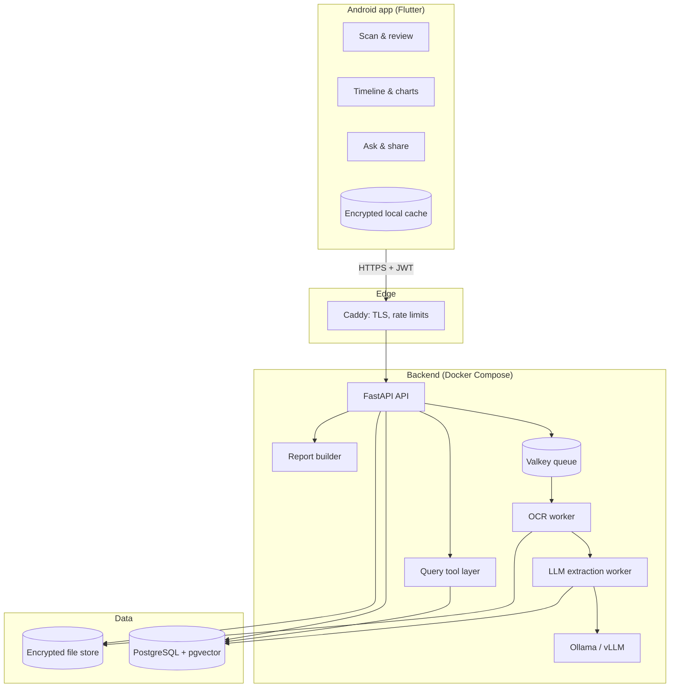
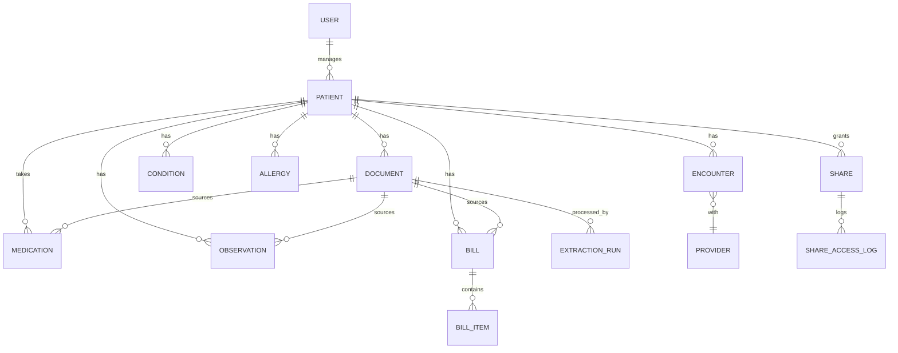
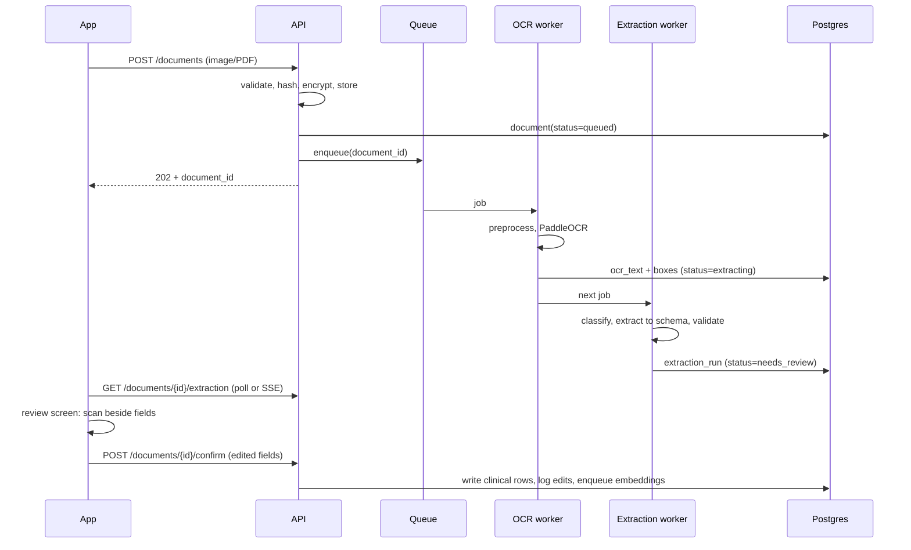

# Health Records App — Architecture & Delivery Plan

> Android app (Flutter) + FastAPI backend. **Open-source components only.**
> Scan medical records and bills, extract structured data with OCR + a local LLM, query it in plain language, and see history as charts. Built for patients and for the clinicians they share with.

**Status:** Draft v1  |  **Owner:** _you_  |  **Audience:** developers, reviewers, future contributors

---

## Table of contents

1. [Goals and non-goals](#1-goals-and-non-goals)
2. [Constraints and open-source policy](#2-constraints-and-open-source-policy)
3. [Users and key scenarios](#3-users-and-key-scenarios)
4. [System overview](#4-system-overview)
5. [Technology stack](#5-technology-stack)
6. [Repository layout](#6-repository-layout)
7. [Data model](#7-data-model)
8. [Core flows](#8-core-flows)
9. [Backend design](#9-backend-design)
10. [OCR and extraction pipeline](#10-ocr-and-extraction-pipeline)
11. [Natural-language query layer](#11-natural-language-query-layer)
12. [Flutter app design](#12-flutter-app-design)
13. [Security and privacy](#13-security-and-privacy)
14. [Deployment and operations](#14-deployment-and-operations)
15. [Testing and quality](#15-testing-and-quality)
16. [Step-by-step delivery plan](#16-step-by-step-delivery-plan)
17. [Risks and mitigations](#17-risks-and-mitigations)
18. [Decision log and open questions](#18-decision-log-and-open-questions)

---

## 1. Goals and non-goals

### Goals

- **Capture:** photograph or import lab reports, prescriptions, discharge summaries, and bills.
- **Extract:** turn them into structured, verified data (observations, medications, conditions, bills).
- **Understand:** let a patient ask "what am I currently taking?" or "how has my HbA1c changed?" and get a cited answer.
- **Visualize:** lab trends, medication timelines, and spending, all computed from structured data.
- **Share:** give a clinician a clear, time-limited, read-only summary the patient controls.
- **Own your data:** self-hosted, exportable, deletable, with no third-party AI or cloud dependency.

### Non-goals (v1)

- Diagnosis, treatment recommendations, or any claim of being a medical device.
- Integration with hospital EHRs (FHIR import/export is a later phase).
- iOS and web clients (the API is client-agnostic, so they can follow).
- Insurance claim submission.
- Multi-tenant SaaS operation (v1 targets a single self-hosted deployment).

### Success criteria

| Metric | Target for MVP |
|---|---|
| Lab-value field accuracy after review screen | 100 % (human-confirmed) |
| Lab-value field accuracy before review (clean scans) | ≥ 90 % |
| Upload → reviewable result | ≤ 60 s per page on the target server |
| Time to answer a timeline question | ≤ 10 s |
| Data leaving the self-hosted environment | None |

---

## 2. Constraints and open-source policy

**Hard rule:** every runtime dependency, model, and service must use an OSI-approved open-source license (or, for model weights, Apache 2.0 / MIT / equivalent permissive terms).

### Policy for adding a dependency

1. Check the license on the project's repository and in `pubspec.yaml` / `pyproject.toml` metadata.
2. Record it in `docs/licenses.md` (name, version, license, purpose).
3. CI runs a license scanner (`pip-licenses` for Python, `flutter pub deps` + `license_checker` for Dart) and fails on anything outside the allow-list: **MIT, BSD-2/3, Apache-2.0, ISC, PostgreSQL, MPL-2.0, LGPL (dynamic use only), OFL (fonts)**.
4. AGPL/GPL components are allowed only as unmodified, separately-run internal services (for example Grafana), never linked into our code.

### Known traps (avoid)

| Avoid | Why | Use instead |
|---|---|---|
| Google ML Kit, Cloud Vision | Proprietary SDK/service | PaddleOCR, Tesseract |
| Firebase (Auth, FCM, Crashlytics) | Proprietary | Own auth; UnifiedPush; self-hosted Sentry or GlitchTip |
| Syncfusion charts | Commercial license | `fl_chart` |
| Hosted LLM APIs (OpenAI, Anthropic, etc.) | Closed service, data leaves the server | Ollama / vLLM with open weights |
| Redis ≥ 7.4 | Not OSI open source | Valkey (BSD) |
| Llama and Gemma weights | Custom licenses, not OSI | Qwen, Mistral (Apache 2.0 variants) |
| Google Play Services dependencies | Proprietary | Plain Android APIs |

### Data licensing caveat

Medical vocabularies are not all open. **LOINC** and **RxNorm** are free but not open source; **SNOMED CT** is licensed per country; **ICD-10** terms vary. If the restriction covers data as well as code, ship a small curated local dictionary (common lab tests, units, aliases) and treat standard codes as optional fields in v1.

---

## 3. Users and key scenarios

| Persona | Needs |
|---|---|
| **Patient / caregiver** | Keep every report in one place, understand current medications and history, track costs, manage a family member's records |
| **Clinician (guest)** | In under a minute, see active conditions, medications, allergies, and trends, with access to the source scans |

### Key scenarios

1. _"I just got blood test results."_ → scan → review extracted values → see them on the trend chart.
2. _"What medicines am I on right now?"_ → ask → answer with citations to the prescriptions.
3. _"How did my cholesterol change this year?"_ → ask or tap → chart with reference band.
4. _"I'm seeing a new specialist tomorrow."_ → create a time-limited share → doctor opens a one-page summary.
5. _"How much did we spend on treatment this quarter?"_ → spending by category chart.

---

## 4. System overview



### Architectural principles

1. **Human in the loop.** Extracted medical data is never committed without user confirmation.
2. **Structured data is the source of truth.** Charts and answers come from database rows, not from free-text model output.
3. **Every fact is traceable.** Each clinical row links to its source document and extraction run.
4. **The LLM is a tool user, not an oracle.** It calls fixed, read-only, parameterized functions. No free-form SQL.
5. **Privacy by architecture.** Everything runs on infrastructure you control.
6. **Modular monolith first.** One FastAPI codebase with clear module boundaries. Split into services only when measurements justify it.
7. **Async by default for heavy work.** OCR and LLM calls run in workers; the API stays responsive.

---

## 5. Technology stack

### Mobile (Flutter, Android)

| Concern | Library | License |
|---|---|---|
| State management | `riverpod` | MIT |
| Navigation | `go_router` | BSD-3 |
| HTTP | `dio` | MIT |
| Models | `freezed`, `json_serializable` | MIT / BSD |
| Local DB | `drift` + SQLCipher (`sqlcipher_flutter_libs`) | MIT / BSD |
| Secure storage | `flutter_secure_storage` | BSD-3 |
| Biometrics | `local_auth` | BSD-3 |
| Camera / picker | `camera`, `image_picker`, `file_picker` | BSD-3 |
| Document cleanup (on-device) | `image` package, optional OpenCV bindings | MIT / Apache |
| Charts | `fl_chart` | MIT |
| PDF export | `pdf`, `printing` | Apache-2.0 |
| Push (optional) | UnifiedPush | Apache-2.0 |
| Testing | `flutter_test`, `mocktail`, `integration_test` | BSD |

### Backend (Python)

| Concern | Choice |
|---|---|
| Framework | FastAPI + Uvicorn, Pydantic v2 |
| ORM / migrations | SQLAlchemy 2, Alembic |
| Auth | `authlib` (JWT), `argon2-cffi`, `pyotp` (optional TOTP) |
| Jobs | Dramatiq (Valkey broker) |
| Image / PDF processing | OpenCV, Pillow, `pypdfium2` (Apache-2.0/BSD) for PDF rendering. Avoid PyMuPDF, which is AGPL |
| OCR | PaddleOCR (primary), Tesseract (fallback) |
| LLM runtime | Ollama or vLLM; Qwen (Apache-2.0) instruct models |
| Embeddings | `bge-m3` or `multilingual-e5` via `sentence-transformers` |
| Encryption | `cryptography` (AES-GCM) |
| PDF reports | WeasyPrint (BSD) or ReportLab (BSD) |
| Testing | pytest, httpx, Testcontainers, `hypothesis` |
| Lint / types | ruff, mypy |

### Infrastructure

PostgreSQL 16+ (pgvector, pg_trgm), Valkey, Caddy, Docker Compose, Prometheus + Loki (+ Grafana, internal only), GlitchTip or self-hosted Sentry, GitHub Actions or self-hosted Gitea + Woodpecker.

---

## 6. Repository layout

Monorepo, so API contracts and clients evolve together.

```
health-app/
├── apps/
│   ├── mobile/                  # Flutter app
│   │   └── lib/
│   │       ├── core/            # theme, routing, DI, network, storage
│   │       ├── data/            # DTOs, repositories, drift DB
│   │       ├── domain/          # entities, use cases
│   │       └── features/
│   │           ├── auth/
│   │           ├── documents/   # capture, upload, review
│   │           ├── timeline/
│   │           ├── labs/        # trend charts
│   │           ├── medications/
│   │           ├── bills/
│   │           ├── ask/
│   │           └── sharing/
│   └── api/                     # FastAPI
│       └── app/
│           ├── main.py
│           ├── core/            # config, security, db, logging
│           ├── modules/
│           │   ├── auth/  patients/  documents/  extraction/
│           │   ├── clinical/  billing/  query/  sharing/  audit/
│           ├── workers/         # ocr.py, extract.py, embed.py, reports.py
│           ├── schemas/         # Pydantic extraction schemas per doc type
│           └── tests/
├── ml/
│   ├── eval/                    # labeled sample docs, scoring scripts
│   └── prompts/                 # versioned extraction prompts
├── deploy/
│   ├── docker-compose.yml  Caddyfile  .env.example
│   └── backup/              # pg_dump + file backup scripts
├── docs/
│   ├── architecture.md  licenses.md  adr/  runbook.md
└── .github/workflows/
```

Each backend module owns its models, schemas, service logic, and router. Modules talk through service interfaces, not each other's tables.

---

## 7. Data model

Shaped after FHIR resources so a future import/export is straightforward, but simplified.



### Key tables

| Table | Important columns |
|---|---|
| `users` | id, email, password_hash, totp_secret_enc, created_at |
| `patients` | id, user_id, display_name, dob, sex, notes |
| `documents` | id, patient_id, type, status (`queued/ocr/extracting/needs_review/confirmed/failed`), storage_key, sha256, page_count, ocr_text, doc_date |
| `extraction_runs` | id, document_id, model, prompt_version, raw_json, field_confidence (jsonb), reviewer_edits (jsonb), created_at |
| `observations` | id, patient_id, test_name, canonical_test_id, value_num, value_text, unit, ref_low, ref_high, flag, collected_at, document_id |
| `medications` | id, patient_id, name, generic_name, dose, route, frequency, start_date, end_date, prescriber_id, status, document_id |
| `conditions` | id, patient_id, name, code (nullable), onset_date, status, document_id |
| `allergies` | id, patient_id, substance, reaction, severity |
| `encounters` | id, patient_id, provider_id, date, reason, summary |
| `bills` / `bill_items` | id, patient_id, provider, date, total, currency, insurer, paid_status; items: description, category, qty, amount |
| `lab_dictionary` | canonical_test_id, name, aliases[], standard_unit, unit_conversions |
| `embeddings` | id, document_id, chunk_text, vector(1024) |
| `shares` / `share_access_log` | scope (jsonb), expires_at, pin_hash, revoked_at; access: ip, user_agent, at |
| `audit_log` | actor, action, entity, entity_id, at |

### Conventions

- UUIDv7 primary keys, `created_at` / `updated_at` everywhere, soft deletes on clinical rows.
- Every clinical row carries `document_id` (nullable only for manual entries).
- Original units are preserved; normalized values are stored alongside.
- Sensitive columns (notes, free text, TOTP secrets) are encrypted at the application layer.

---

## 8. Core flows

### 8.1 Ingest and review



### 8.2 Ask a question

1. `POST /ask { patient_id, question }`.
2. The LLM receives the question plus tool definitions (never raw data).
3. It emits tool calls, such as `get_active_medications()` or `get_observations("HbA1c", from, to)`.
4. The backend validates arguments, executes parameterized queries scoped to the patient, and returns rows.
5. The LLM composes an answer that must reference record IDs. The API converts these to citations (document + page).
6. If nothing relevant is found, the answer says so instead of guessing.

### 8.3 Charts

The app calls dedicated endpoints (`/patients/{id}/charts/lab/{test}`, `/charts/medications`, `/charts/spending`). Responses are plain series data; `fl_chart` renders them. No LLM involved.

### 8.4 Clinician share

1. Patient picks scope (date range, record types), expiry, and optionally a PIN.
2. API creates a `share` with an unguessable token.
3. The clinician opens `https://host/s/{token}`, enters the PIN if required, and sees a server-rendered read-only summary (active conditions, medications, allergies, latest labs with trends, linked source scans).
4. Each view is written to `share_access_log`; the patient sees the log and can revoke instantly.

---

## 9. Backend design

### 9.1 API surface (v1, REST + JSON, versioned under `/api/v1`)

| Area | Endpoints |
|---|---|
| Auth | `POST /auth/register`, `/auth/login`, `/auth/refresh`, `/auth/logout`, `/auth/totp/*` |
| Patients | `GET/POST /patients`, `PATCH /patients/{id}` |
| Documents | `POST /documents`, `GET /documents`, `GET /documents/{id}`, `GET /documents/{id}/file`, `GET /documents/{id}/extraction`, `POST /documents/{id}/confirm`, `DELETE /documents/{id}` |
| Clinical | CRUD for `/observations`, `/medications`, `/conditions`, `/allergies`, `/encounters` |
| Charts | `/patients/{id}/charts/lab/{test}`, `/charts/medications`, `/charts/spending` |
| Bills | CRUD `/bills` |
| Ask | `POST /ask`, `GET /ask/history` |
| Sharing | `POST /shares`, `GET /shares`, `DELETE /shares/{id}`, public `GET /s/{token}` |
| Data rights | `POST /export` (ZIP of JSON + originals), `DELETE /account` |

OpenAPI is generated from FastAPI; the Dart client is generated from it (`openapi-generator`, Apache-2.0) in CI to keep contracts in sync.

### 9.2 Cross-cutting

- **Authorization:** every query is scoped by `patient_id` through a dependency that checks ownership. Add Postgres Row-Level Security as defense in depth.
- **Idempotency:** uploads carry a client-generated key plus SHA-256 to avoid duplicates.
- **Validation:** file type allow-list (JPEG, PNG, PDF), size caps, page caps, content sniffing.
- **Errors:** RFC 7807 problem details.
- **Logging:** structured JSON, with PHI redaction. Never log OCR text or extracted values.
- **Versioning:** extraction prompts and schemas are versioned; each `extraction_run` records which.

### 9.3 Workers

| Worker | Responsibility | Scaling note |
|---|---|---|
| `ocr` | Preprocess + OCR, store text and layout | CPU-bound, scale by process count |
| `extract` | Classify, extract, validate, score | Bound by LLM throughput; limit concurrency |
| `embed` | Chunk and embed confirmed text | Low priority queue |
| `reports` | Build PDF summaries | On demand |

Retries with exponential backoff, a dead-letter state surfaced to the user as "couldn't process, try a clearer photo or enter manually".

---

## 10. OCR and extraction pipeline

### 10.1 Stages

1. **Intake check (on device):** blur and brightness heuristics, edge detection and crop, then a prompt to retake if the image is poor.
2. **Preprocess (server):** auto-rotate, deskew, denoise, adaptive threshold when needed, split multi-page PDFs.
3. **OCR:** PaddleOCR (detection + recognition + layout/table structure). Fall back to Tesseract for low-confidence pages or specific scripts. Persist text, bounding boxes, and per-line confidence.
4. **Classification:** a lightweight rule/keyword pass first (e.g. "Reference Range", "Rx", "Invoice"), then LLM if ambiguous.
5. **Extraction:** the LLM fills a per-type Pydantic schema using constrained JSON output. Prompts are versioned in `ml/prompts/`.
6. **Validation and normalization:**
   - parse dates (day-first/month-first heuristics from document context);
   - map test names to `lab_dictionary` aliases;
   - normalize units and flag unknown ones;
   - range sanity checks per test;
   - reconcile bill line items against the stated total.
7. **Confidence scoring:** combine OCR line confidence, schema validity, dictionary match, and range plausibility into a per-field score.

### 10.2 Example schema

```python
class LabObservation(BaseModel):
    test_name: str
    value: float | None
    value_text: str | None          # e.g. "Negative", "<0.5"
    unit: str | None
    ref_low: float | None
    ref_high: float | None
    flag: Literal["low", "normal", "high", "critical"] | None
    collected_on: date | None
    source_span: list[int]          # OCR line ids for highlighting in the app

class LabReport(BaseModel):
    lab_name: str | None
    patient_name: str | None
    report_date: date | None
    observations: list[LabObservation]
```

Similar schemas exist for `Prescription`, `DischargeSummary`, and `Bill`.

### 10.3 Review screen requirements

- Original image with highlighted regions on one side, editable fields on the other.
- Low-confidence fields highlighted and sorted first.
- "Patient name mismatch" warning if the extracted name differs from the profile.
- One tap to confirm all, or fix individual fields. Every edit is stored in `reviewer_edits` and later feeds the evaluation set.

---

## 11. Natural-language query layer

### Tool catalogue (read-only, patient-scoped)

| Tool | Purpose |
|---|---|
| `get_active_medications()` | Current medicines with dose, frequency, prescriber |
| `get_medication_history(name?, from?, to?)` | Past and current courses |
| `get_conditions(status?)` | Diagnoses and status |
| `get_observations(test, from?, to?)` | Lab series |
| `get_latest_observations(tests[])` | Most recent values |
| `get_encounters(from?, to?)` | Visits |
| `get_bills(from?, to?, category?)` | Spending |
| `search_documents(query)` | Hybrid search (pg_trgm + pgvector) over confirmed text |

### Rules

- The model chooses tools; the server validates arguments with Pydantic and executes them.
- Results are limited in size and include record IDs.
- The final answer is checked: any claim without a record reference is dropped or marked as unverified.
- The system prompt forbids diagnosis, dosing advice, and interpretation beyond restating records; it always suggests consulting a clinician for decisions.
- Prompt-injection stance: OCR text and document content are treated as data, never instructions; tools cannot write.

---

## 12. Flutter app design

### Architecture

Clean layering with Riverpod:

```
UI (widgets) → Controllers (Notifier/AsyncNotifier) → Use cases → Repositories → { Remote (dio), Local (drift+SQLCipher) }
```

### Screens

| Area | Screens |
|---|---|
| Onboarding | Sign up / login, biometric lock setup, create first patient profile |
| Home | Summary cards: active medications, recent results, upcoming follow-ups, spending this month |
| Capture | Camera with edge detection, multi-page batch, import PDF/gallery |
| Documents | List with status chips, document viewer |
| Review | Side-by-side image and fields, confidence highlights |
| Timeline | Chronological feed of encounters, labs, prescriptions, bills with filters |
| Labs | Test list, trend chart with reference band, table toggle |
| Medications | Active vs past, timeline (Gantt-style) |
| Bills | List, spending by month and category |
| Ask | Chat with citation chips that open the source document page |
| Share | Create share, QR/link, access log, revoke |
| Settings | Profiles, export, delete account, app lock, server URL |

### Offline and sync

- Cache confirmed records locally (read-only) for offline timeline viewing.
- Uploads queue locally and resume when online (`workmanager`, BSD).
- Conflict policy: server is authoritative; edits are made online.

### UX guardrails

- A persistent "not medical advice" note on the Ask screen.
- Clear "unverified" labels for anything not confirmed.
- Accessibility: large text support, sufficient contrast, TalkBack labels.

---

## 13. Security and privacy

| Layer | Controls |
|---|---|
| Transport | TLS 1.2+ via Caddy, HSTS; certificate pinning in the app optional |
| Authentication | Argon2id, short-lived access JWT (≈15 min), rotating refresh tokens, optional TOTP, login rate limits |
| Authorization | Patient-scoped dependency checks + Postgres RLS |
| Data at rest | Full-disk encryption; AES-GCM for files and sensitive columns; per-user data keys wrapped by a master key stored outside the DB |
| Device | Keystore-backed secure storage, biometric app lock, SQLCipher cache, `FLAG_SECURE`, auto-lock timeout |
| AI | Local models only; no PHI in logs; read-only tools; schema-validated outputs |
| Sharing | High-entropy token, expiry, optional PIN, access log, instant revoke |
| Audit | Append-only audit log for reads of shared data, exports, deletions, and auth events |
| Backups | Encrypted, tested restores, retention policy |
| Supply chain | Pinned dependencies, license + vulnerability scanning (`pip-audit`, `osv-scanner`) in CI |

### Compliance checklist (before real users)

- [ ] Identify applicable law (HIPAA, GDPR, local health-data rules) and data-residency needs
- [ ] Consent and privacy policy; data processing documentation
- [ ] Export and hard-delete flows working end to end
- [ ] Breach response procedure
- [ ] Threat model review and external security review
- [ ] Clear positioning: personal record keeper, not a medical device

---

## 14. Deployment and operations

### Services (Docker Compose)

```
caddy        # TLS, reverse proxy, rate limiting
api          # FastAPI (uvicorn workers)
worker-ocr   # Dramatiq
worker-llm   # Dramatiq (concurrency 1-2)
postgres     # with pgvector, pg_trgm
valkey       # queue + cache
ollama       # Qwen instruct + embedding model
seaweedfs    # optional; plain encrypted volume is fine for MVP
```

### Sizing guide (MVP, single user group)

- 4–8 vCPU, 16–32 GB RAM, NVMe storage. CPU-only works with a 3–7B quantized model; a single consumer GPU makes extraction roughly an order of magnitude faster.
- Expect a few seconds to tens of seconds per document on CPU. The queue and status UI hide this from users.

### Operations

- **CI/CD:** lint, type-check, tests, license scan, build images, run migrations, deploy.
- **Observability:** Prometheus metrics (queue depth, OCR/LLM latency, failure rates), Loki logs, GlitchTip errors, uptime check.
- **Backups:** nightly `pg_dump` + file sync, encrypted, offsite; monthly restore drill.
- **Config:** 12-factor, secrets via env/Docker secrets, `.env.example` committed.
- **Runbook:** `docs/runbook.md` covers restart procedures, key rotation, restore, and handling a stuck queue.

---

## 15. Testing and quality

| Level | What |
|---|---|
| Unit | Normalization, validators, tool argument checks, repository logic |
| API / integration | pytest + Testcontainers (real Postgres, Valkey); auth and ownership tests for every endpoint |
| Pipeline evaluation | `ml/eval/`: 100–200 anonymized or synthetic documents with ground truth; scripts compute field-level precision/recall per doc type, tracked per prompt/model version |
| Regression gate | CI fails if extraction F1 drops beyond a set threshold on the eval set |
| Mobile | Widget tests for key screens, integration tests for capture→review→confirm with a mocked API |
| Security | Authorization matrix tests, dependency scanning, basic fuzzing of upload endpoints |
| Manual | Real-device camera tests across lighting and paper types; clinician usability session on the share view |

**Test data:** never use real patient records in the repository. Use synthetic documents (generated from templates with fake values) and consented, anonymized samples stored outside the repo.

---

## 16. Step-by-step delivery plan

Each phase ends with a demoable result and explicit exit criteria. Durations assume one developer working part-time to full-time; adjust to your pace.

### Phase 0 — Foundations (Week 1)

**Objective:** an agreed scope, a clean repo, and a working skeleton.

- [ ] Finalize scope, personas, and this document; create ADRs for key choices
- [ ] Monorepo, `docs/licenses.md`, license-scan CI job
- [ ] Docker Compose with Postgres, Valkey, Caddy, API "hello world"
- [ ] Flutter project with theme, routing, Riverpod, and a health-check call to the API
- [ ] Collect a first **synthetic and anonymized sample set** (10–20 lab reports, prescriptions, bills) for development

**Exit:** `docker compose up` brings the stack up; the app shows "API reachable".

### Phase 1 — Accounts and secure storage (Weeks 2–3)

**Objective:** users, patient profiles, and safe file handling.

- [ ] Auth (register, login, refresh, logout), argon2id, rate limiting
- [ ] Patients CRUD, ownership checks, RLS policies
- [ ] Encrypted file storage service and key management
- [ ] Upload endpoint with validation, hashing, deduplication
- [ ] App: onboarding, login, biometric lock, profile switcher, upload from gallery
- [ ] Audit log basics

**Exit:** a user can sign in, create a profile, upload a file, and see it listed; files are verified to be encrypted on disk; authorization tests pass.

### Phase 2 — OCR pipeline (Weeks 4–5)

**Objective:** reliable text from real-world photos.

- [ ] Worker infrastructure, job states, retries, status API
- [ ] Preprocessing (rotation, deskew, denoise, PDF splitting)
- [ ] PaddleOCR integration with Tesseract fallback; store text + boxes + confidence
- [ ] App: camera capture with edge detection and quality warnings; multi-page; progress UI
- [ ] Evaluation script: character/word error rate on the sample set

**Exit:** ≥ 95 % word accuracy on clean printed samples; clear failure messaging on bad images.

### Phase 3 — Lab report extraction and review (Weeks 6–8)

**Objective:** the first end-to-end value: scan a lab report and get verified data.

- [ ] Local LLM serving (Ollama), prompt + schema for lab reports, JSON-constrained output
- [ ] Lab dictionary (aliases, units, conversions) and validators
- [ ] Confidence scoring; per-field source spans
- [ ] Extraction run storage and prompt/model versioning
- [ ] App: **review screen** (image beside fields, highlights, edits, confirm)
- [ ] Confirm endpoint writes `observations`; edit logging
- [ ] Eval harness for extraction F1 with CI gate

**Exit:** on the eval set, ≥ 90 % field accuracy before review for clean scans; the review flow takes under ~1 minute per report.

### Phase 4 — Charts and timeline (Weeks 9–10)

**Objective:** make the history visible.

- [ ] Chart endpoints (lab series with reference bands)
- [ ] App: lab list, trend chart (`fl_chart`), table view, date filters
- [ ] Unified timeline feed with filters
- [ ] Offline cache for confirmed data

**Exit:** a user with several reports sees clear trends; works offline for viewing.

### Phase 5 — Prescriptions, conditions, medications (Weeks 11–13)

**Objective:** "what am I on now, and what was I on before?"

- [ ] Schemas and prompts for prescriptions and discharge summaries
- [ ] Medication model with start/end inference and manual editing
- [ ] Conditions and allergies, encounters linking
- [ ] App: medication timeline, active vs past, condition list
- [ ] Handwriting reality check: measure accuracy on handwritten prescriptions and set clear UX expectations (manual-entry fallback)

**Exit:** active-medication view is correct on the test cases after review; handwriting limits are documented.

### Phase 6 — Bills and spending (Weeks 14–15)

- [ ] Bill schema, line-item extraction, total reconciliation, category mapping
- [ ] Spending charts by month and category; link bills to encounters
- [ ] App: bills list, detail, charts

**Exit:** bill totals reconcile with line items; monthly spending chart verified against manual calculations.

### Phase 7 — Ask your records (Weeks 16–18)

- [ ] Embeddings pipeline and hybrid search
- [ ] Tool layer with validated arguments
- [ ] LLM orchestration, citation enforcement, refusal rules
- [ ] App: chat UI with citation chips opening source pages
- [ ] Question test suite (50+ questions with expected tool calls and answers)

**Exit:** ≥ 90 % of test questions answered correctly with valid citations; zero answers that contain uncited medical claims in the suite.

### Phase 8 — Clinician sharing and export (Weeks 19–20)

- [ ] Share creation, token + PIN, expiry, revoke
- [ ] Server-rendered clinician summary page; PDF generation
- [ ] Access log in app
- [ ] Data export (ZIP) and account deletion

**Exit:** a clinician (or a proxy tester) can read the summary on a phone browser in under a minute; revocation takes effect immediately.

### Phase 9 — Hardening and beta (Weeks 21–24)

- [ ] Threat model review, penetration-style testing, dependency audit
- [ ] Performance tuning (OCR concurrency, LLM quantization, DB indexes)
- [ ] Backup/restore drill, monitoring dashboards, runbook
- [ ] Accessibility and usability pass; Android release build, signing, F-Droid-compatible build (no proprietary dependencies) as the distribution path
- [ ] Legal/compliance review; privacy policy; consent flows
- [ ] Closed beta with a few households; collect feedback and corrected extractions into the eval set

**Exit:** no known high-severity issues; successful restore drill; beta users complete the core scenarios unaided.

### Later (post-MVP backlog)

- FHIR R4 import/export; sync with hospital portals where open standards exist
- Medication reminders and refill tracking
- Vitals from wearables via open protocols (e.g. Health Connect data the user chooses to import)
- Multilingual UI and OCR packs (Nepali, Hindi, others)
- Fine-tuned extraction model trained on reviewed corrections (license-compliant data only)
- iOS and web clients
- Family sharing with roles

---

## 17. Risks and mitigations

| # | Risk | Likelihood | Impact | Mitigation |
|---|---|---|---|---|
| 1 | OCR misreads digits or units, leading to wrong medical data | High | High | Mandatory review, range checks, confidence highlights, original image always one tap away |
| 2 | LLM hallucinates or mislabels fields | Medium | High | Schema validation, source spans, eval gate, citations required for answers |
| 3 | Handwritten prescriptions are unreadable | High | Medium | Set expectations, manual entry fallback, treat as stretch goal |
| 4 | CPU-only inference is too slow | Medium | Medium | Async queue + status UI, quantized models, optional GPU |
| 5 | Regional lab formats and scripts vary | High | Medium | Multilingual OCR models, template hints, grow eval set from corrections |
| 6 | Privacy breach or regulatory non-compliance | Low | Very high | Threat modeling, encryption, audit, legal review, minimal data retention |
| 7 | A dependency violates the open-source rule | Medium | Medium | License scanner in CI, allow-list, `licenses.md` review |
| 8 | Scope creep | High | Medium | Phase exit criteria; backlog for post-MVP items |
| 9 | Users treat answers as medical advice | Medium | High | Disclaimers, refusal rules, no interpretation beyond records |
| 10 | Single-server failure or data loss | Low | High | Encrypted offsite backups, restore drills |

---

## 18. Decision log and open questions

### Decisions (to formalize as ADRs)

| ID | Decision | Rationale |
|---|---|---|
| ADR-001 | Modular monolith (FastAPI) | Fastest path, simple ops, easy to split later |
| ADR-002 | PostgreSQL + pgvector (no separate vector DB) | One datastore, transactional consistency |
| ADR-003 | PaddleOCR primary, Tesseract fallback | Better layout/table handling, both Apache-2.0 |
| ADR-004 | Local LLM via Ollama/vLLM, Apache-2.0 weights | Meets license and privacy constraints |
| ADR-005 | Tool-calling over text-to-SQL | Safer, auditable, patient-scoped |
| ADR-006 | Mandatory human review before commit | Medical data accuracy |
| ADR-007 | FHIR-inspired schema, standard codes optional | Portability without data-license entanglement |
| ADR-008 | Dramatiq + Valkey for jobs | Simple, reliable, open-source |

### Open questions

1. Which languages and scripts must OCR support at launch (English only, or Nepali/Hindi as well)?
2. Hosting target: home server, VPS, or a clinic's own infrastructure? Is a GPU available?
3. Is this for personal/family use only, or will other people's data be stored (affects compliance scope)?
4. Which jurisdictions' health-data rules apply?
5. Distribution: Play Store, F-Droid, or sideloaded APK? (Play Store is acceptable for distribution, but the app itself must contain no proprietary SDKs.)
6. Do you want standard medical coding (ICD, LOINC) in v1, given licensing, or only local dictionaries?

---

_Next step: resolve the open questions above, then start Phase 0._
